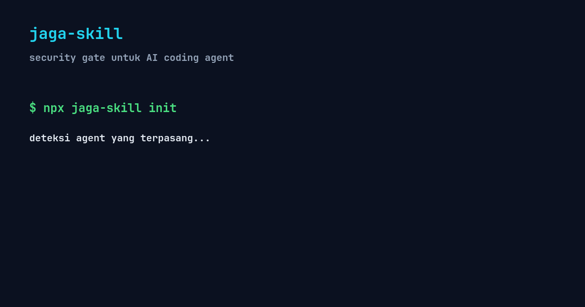

# jaga-skill

[](https://www.npmjs.com/package/jaga-skill)
[](https://github.com/Emil-02/jaga-skill/actions/workflows/ci.yml)

Saya bikin `jaga-skill` supaya agent coding berhenti dulu sebelum commit atau deploy kalau ada secret, data pribadi, atau konfigurasi yang berbahaya.

```sh
npx jaga-skill init
```

Jalan di OpenCode, Claude Code, Codex, Gemini CLI, dan Cursor.



```sh
npx jaga-skill doctor
npx jaga-skill check --format sarif
npx jaga-skill uninstall
```

Dokumentasi lengkap ada di [`README.md`](README.md).

Dibuat dan dipelihara oleh [@Emil-02](https://github.com/Emil-02).
