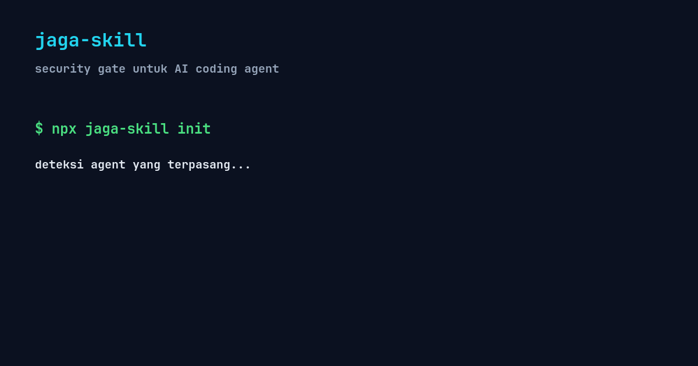

# jaga-skill

[](https://www.npmjs.com/package/jaga-skill)
[](https://github.com/Emil-02/jaga-skill/actions/workflows/ci.yml)
[](LICENSE)

Saya bikin `jaga-skill` karena agent coding sekarang makin sering commit dan deploy sendiri, tapi belum punya kebiasaan berhenti sejenak untuk cek secret atau data pribadi. Cukup satu perintah, agent Anda dapat pengawal yang bekerja sebelum kode keluar dari laptop.

```sh
npx jaga-skill init
```

Pasang di OpenCode, Claude Code, Codex, Gemini CLI, Cursor, atau pakai fallback `AGENTS.md` untuk agent lain.



## Kenapa saya bikin ini

Skill AI kebanyakan isinya cuma instruksi: "hati-hati ya". Saya mau yang lebih nyata. Di balik `jaga-skill` ada [`jaga`](https://github.com/Emil-02/jaga), scanner Go yang jalan lokal dan menghasilkan SARIF. Jadi agent tidak cuma disuruh hati-hati — dia dikasih bukti yang bisa dibaca dan diperbaiki. Tidak ada upload, tidak ada telemetri.

## Gimana caranya kerja

```
npx jaga-skill init → deteksi agent → tulis SKILL.md + manifest
        ↓
agent mau commit/deploy → jaga-skill check → SARIF → perbaiki → check lagi
```

## Pasang dan pakai

```sh
npm install -g jaga-skill   # atau cukup npx di bawah
npx jaga-skill init              # pasang ke semua agent yang terdeteksi
npx jaga-skill init --dry-run    # lihat rencana dulu, tanpa menulis
npx jaga-skill init --with-hook  # sekalian pasang git pre-commit hook
npx jaga-skill doctor            # cek kesehatan instalasi
npx jaga-skill check             # jalankan pemeriksaan
npx jaga-skill check --format sarif
npx jaga-skill uninstall         # hapus hanya file yang dikelola
```

File yang saya tulis:

| Agent | Lokasi |
|---|---|
| OpenCode | `.opencode/skills/jaga/SKILL.md` |
| Claude Code | `.claude/skills/jaga/SKILL.md` |
| Codex | `AGENTS.md` (blok bermarker) |
| Gemini CLI | `GEMINI.md` (blok bermarker) |
| Cursor | `.cursor/rules/jaga.mdc` |
| Fallback | `AGENTS.md` |

Semua tercatat di `.jaga-skill.json` berisi hash dan versi. Makanya install ulang aman, dan uninstall tidak pernah menyentuh file punya Anda.

## Scanner yang dipakai

`jaga-skill check` memilih, berurutan:

1. `JAGA_BIN` atau `jaga` yang sudah ada di PATH — scanner penuh
2. scanner JS bawaan — subset aturan, tanpa jaringan, langsung jalan
3. Go via `JAGA_USE_GO=1` — kalau mau scanner penuh tanpa binary dipasang
4. binary rilis dengan verifikasi SHA-256 — masih dalam rencana

## Konfigurasi

`jaga.skill.yml` opsional:

```yaml
fail_on: high
exclude:
  - dist
  - node_modules
checks:
  secret: true
  pii: true
  hygiene: true
```

Schemanya ada di [`schema/config.schema.json`](schema/config.schema.json).

## Struktur kode

Kalau penasaran gimana saya menyusun adapter per agent, baca [`docs/ARCHITECTURE.md`](docs/ARCHITECTURE.md).

## Kontribusi

Kalau agent favorit Anda belum didukung, saya senang kalau Anda bikin issue atau PR. Caranya ada di [`CONTRIBUTING.md`](CONTRIBUTING.md).

## Lisensi

MIT. Dibuat dan dipelihara oleh [@Emil-02](https://github.com/Emil-02).
